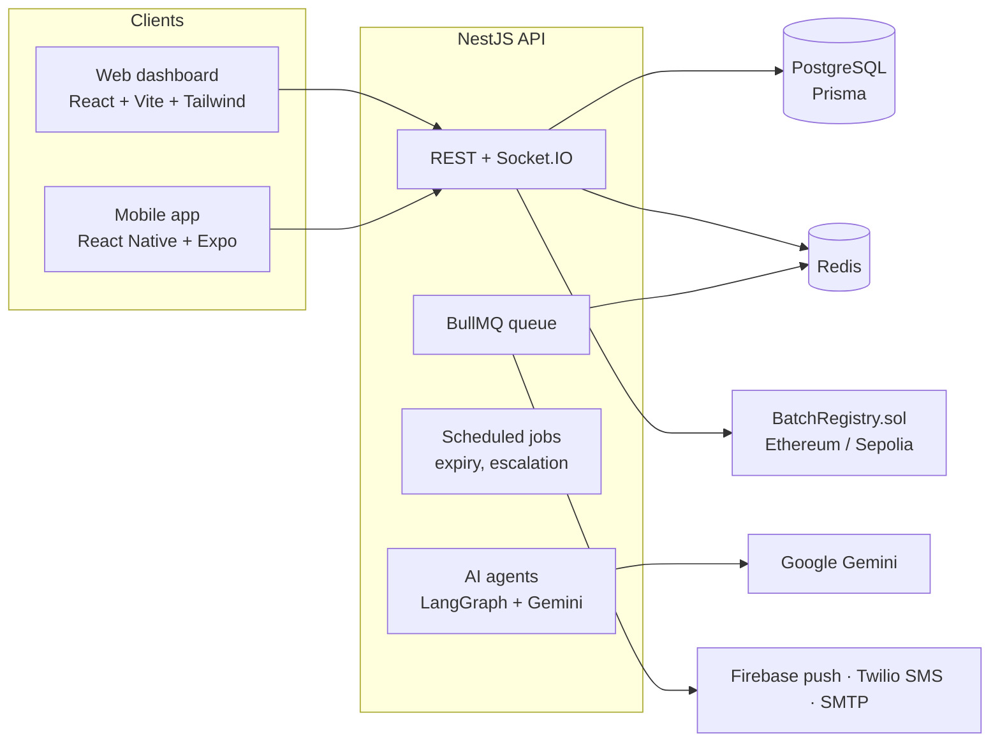

# PharmaGuard AI

**Autonomous pharmaceutical safety & recall management platform.**

PharmaGuard AI tracks every medicine batch from manufacturer to patient, stores a tamper-proof fingerprint of each batch on the Ethereum blockchain, blocks unsafe sales at the counter, and uses AI agents to run drug recalls end to end. When a batch becomes unsafe (expired, recalled or tampered with) its digital identity is revoked on-chain, so it can never re-enter the supply chain.

> Web dashboard for manufacturers, distributors, hospitals and regulators · Mobile app for pharmacies, hospitals and field staff · NestJS API · Solidity smart contract

---

## Features

| Area | What it does |
|---|---|
| **Blockchain traceability** | Each batch gets a keccak256 fingerprint (number, drug, dates, quantity) stored in the `BatchRegistry` smart contract. Verification recomputes the hash from the database and compares it with the chain, so any database edit is detected as tampering. |
| **Self-destructing digital identity** | Expired, recalled or tampered batches are revoked in the database **and on-chain** (`revokeBatch`). After that, QR verification fails, sales and transfers are blocked, and every holder gets a return/disposal notice. |
| **Smart-contract sale blocking** | At the counter, a QR scan checks blockchain integrity, on-chain revocation, recall status, expiry and stock before approving a sale. Every blocked attempt is written to the violation log. |
| **Agentic AI recall management** | A LangGraph workflow of five agents (Recall → Inventory → Compliance → Notification → Summary) locates every unit, creates a task per holder with a severity-based deadline (24h–7d), notifies them, and writes a Gemini summary. A scheduler escalates overdue tasks to regulators and closes the recall automatically when everyone is done. |
| **AI insights & assistant** | Expiry-risk and recall-risk scores with explanations, a 3-month demand forecast, stock-out prediction, recommendations, and a chat assistant that only answers from data the user's role may see. Powered by Google Gemini, with a rule-based fallback. |
| **Expiry enforcement** | A daily job warns holders 30 days before expiry and auto-revokes expired batches. |
| **Disposal & returns** | Return/destroy notices with evidence. When every holder has destroyed it, the batch is marked `DESTROYED`. |
| **Inventory & transfers** | Role rules: Manufacturer → Distributor → Pharmacy / Hospital, with stock validation and full history. |
| **Map-based visibility** | Leaflet map of where stock sits, with a recall-impact view. |
| **Notifications** | Real-time (Socket.IO), mobile push (Firebase), SMS for urgent alerts (Twilio) and email, delivered through a BullMQ queue on Redis. |
| **Compliance** | Audit log of every critical action, violation log, compliance reports, CSV / Excel / PDF exports, safety KPIs. |
| **Security** | JWT + bcrypt, role-based access for 6 roles, organisation registration with approval and email activation, Helmet, rate limiting, password hashes never leave the API. Mobile: secure token storage and fingerprint / Face ID unlock. |

## Architecture



## Tech stack

- **Backend:** NestJS 11, TypeScript, PostgreSQL, Prisma 6 (Rust-free client + `pg` adapter), Redis, BullMQ, Socket.IO, Swagger
- **AI:** Google Gemini (`@google/genai`), LangGraph (`@langchain/langgraph`)
- **Blockchain:** Solidity 0.8.20, OpenZeppelin AccessControl, Hardhat 2, ethers v5
- **Web:** React 19, Vite, Tailwind CSS 4, Recharts, React Leaflet
- **Mobile:** React Native 0.81, Expo 54, expo-camera, Firebase Messaging, expo-local-authentication, expo-secure-store
- **Tooling:** Turborepo, Jest, GitHub Actions, Render, Vercel, EAS Build

## Repository layout

```
apps/
  backend/     NestJS API (src/modules/*), Prisma schema & migrations, scripts/
  web/         React dashboard
  mobile/      Expo app
blockchain/    BatchRegistry.sol, tests, deploy scripts
docs/          Deployment guide
render.yaml    Render blueprint (API + Postgres + Redis)
```

## Run locally

Prerequisites: Node 20+, PostgreSQL, (optional) Redis.

```bash
npm install                      # all workspaces
cd blockchain && npm install

# 1. Local blockchain + contract
cd blockchain
npx hardhat node                 # terminal 1
npm run deploy:local             # terminal 2 → prints the contract address

# 2. API
cd apps/backend
cp .env.example .env             # set DATABASE_URL (and GEMINI_API_KEY if you have one)
npx prisma migrate deploy
npm run seed                     # demo users, password Demo@1234
npm run start:dev                # http://localhost:3000, docs at /api/docs

# 3. Web
cd apps/web
npm run dev                      # http://localhost:5173

# 4. Mobile
cd apps/mobile
EXPO_PUBLIC_API_URL=http://<your-LAN-IP>:3000 npx expo start
```

Optional: `bash apps/backend/scripts/demo-data.sh` loads batches, transfers and an active recall.

### Demo accounts

All use the password `Demo@1234`.

| Role | Email |
|---|---|
| Super Admin | admin@pharmaguard.ai |
| Regulator | regulator@pharmaguard.ai |
| Manufacturer | manufacturer@pharmaguard.ai |
| Distributor | distributor@pharmaguard.ai |
| Pharmacy | pharmacy@pharmaguard.ai |
| Hospital | hospital@pharmaguard.ai |

## Testing

```bash
npm test --workspace=backend         # 22 unit tests
cd blockchain && npx hardhat test    # 7 smart-contract tests
API=http://localhost:3000 DATABASE_URL=... bash apps/backend/scripts/e2e-smoke.sh   # 44 end-to-end checks
```

The end-to-end script exercises every role: RBAC, blockchain registration and verification, transfers, sale blocking, the AI recall workflow through to on-chain revocation and disposal, the expiry engine, tamper detection, AI insights and compliance reports.

## Deployment

See **[docs/DEPLOYMENT.md](docs/DEPLOYMENT.md)**: Render (API, Postgres, Redis), Vercel (web), Sepolia (contract) and EAS (Android APK), all on free tiers.

## Role permissions

| Module | Super Admin | Regulator | Manufacturer | Distributor | Pharmacy / Hospital |
|---|:-:|:-:|:-:|:-:|:-:|
| Dashboard, AI insights, assistant | ✅ | ✅ | ✅ | ✅ | ✅ |
| Batches | View | View | Manage | ❌ | ❌ |
| Inventory | All | All | Own | Own | Own |
| Create transfer | ❌ | ❌ | → Distributor | → Pharmacy / Hospital | ❌ |
| Transfer history | All | All | Own | Own | Received |
| Recalls | Initiate | Initiate | View + tasks | View + tasks | View + tasks |
| Revocation / disposal | ✅ | ✅ | Own | Own | Own |
| Compliance, violations, analytics | ✅ | ✅ | ❌ | ❌ | ❌ |
| User management | ✅ | ❌ | ❌ | ❌ | ❌ |
